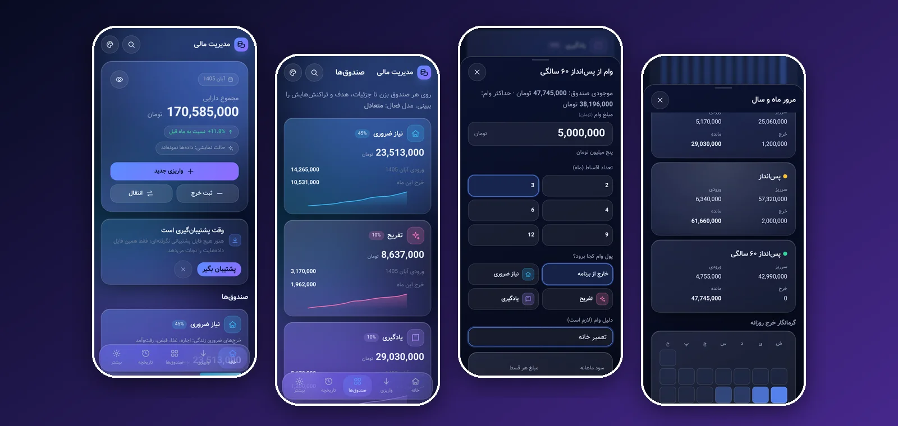
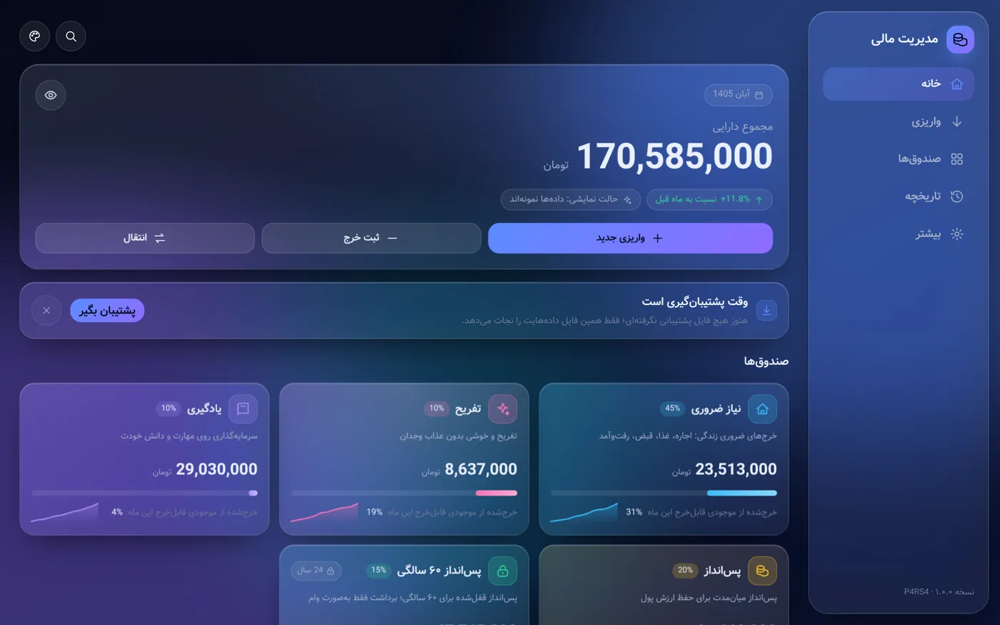
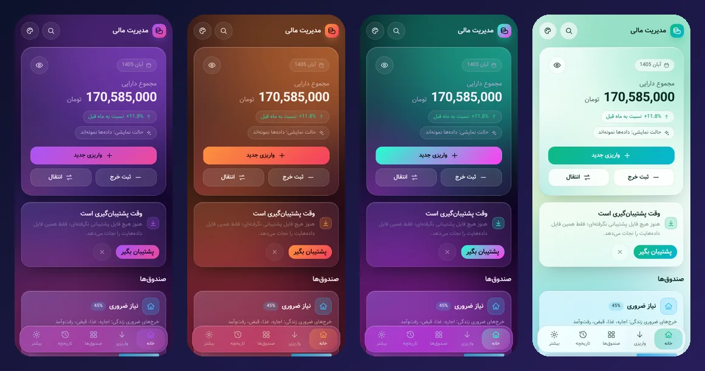

<a id="top"></a>
<div align="center">



# 💎 Finance Manager &nbsp;·&nbsp; مدیریت مالی

### Split every income into purpose-driven buckets. Beautiful, private, offline.

[](https://p4rs4-3.github.io/finance-manager/)
[](CHANGELOG.md)
[](#-install)
[](#-privacy--your-data)
[](#-for-developers)

**English** &nbsp;|&nbsp; [فارسی](#-فارسی)

</div>

---

## ✨ What is it?

**Finance Manager** is a personal budgeting app. You enter an income — the app instantly **splits it by percentage across five buckets**, so every coin has a job before you spend it:

| Bucket | Default % | Purpose |
|---|:---:|---|
| 🏠 Essentials | **45%** | Rent, food, bills, transport |
| ✨ Fun | **10%** | Guilt-free enjoyment |
| 📚 Learning | **10%** | Investing in skills and knowledge |
| 🪙 Savings | **20%** | Mid-term savings that protect value |
| 🔒 Retirement (age 60) | **15%** | Locked — can only be borrowed from, with interest |

It runs entirely in your browser, stores everything on your own device, works with **no internet** after the first load, and installs like a native app on **Android, iOS and Windows**.

> 🇮🇷 Built Persian-first: full RTL layout, Jalali (Solar Hijri) calendar by default, toman/rial, English digits. A Gregorian calendar switch is in Settings.

## 🖼️ Screenshots

<div align="center">

<br><br>

<br>
<sub>24 themes · light & dark · glass effect intensity · accent colour — all adjustable</sub>
</div>

## 🚀 Features

<table>
<tr>
<td width="50%" valign="top">

### 💰 Money flow
- Enter an income → **instant percentage split** with preview & confirmation
- Integer-exact maths (largest-remainder), never a lost coin
- **Per-deposit percentage snapshot** — changing a model never rewrites history
- Custom percentage models (one-decimal precision), warning if savings get 0%
- Expenses with **80% / 100% monthly cap alerts**; overspending needs a two-step confirmation
- Unspent money carries over to next month
- Free transfers between buckets (except *out of* the retirement bucket)

</td>
<td width="50%" valign="top">

### 🔒 Retirement bucket & loans
- Locked until you need it — withdrawals only as a **loan**
- Up to **80%** of the balance; monthly interest **20%** (≤ 50%) / **30%** (above)
- **2–12 equal instalments**, early payoff allowed, interest returns to the bucket
- **24-hour cooling-off** + typed confirmation phrase + required reason
- Escalating late fee after a 3-day grace period
- One loan at a time; full cost shown *before* you commit

</td>
</tr>
<tr>
<td valign="top">

### 📊 Insight
- Home dashboard: total assets, per-bucket progress, donut & trend charts
- **Month & year review**: income vs. spending, savings rate, vs. previous month
- **Daily-spending heatmap**, top expenses, spending by `#hashtag`
- **Month closing** to protect finished months
- Global search (`Ctrl+K` or `/`), history filters, hashtags with management

</td>
<td valign="top">

### 🔔 Reminders & export
- In-app reminders: instalments, monthly deposit, month-end, backup
- Optional system notifications (while the app is opened)
- Export to **CSV · Excel · Word · PDF · ICS** (loan instalments → your calendar)
- Backup & restore as a validated JSON file; automatic rolling snapshots
- Data health check, 30-day recycle bin, audit log

</td>
</tr>
<tr>
<td valign="top">

### 🎨 Design
- Frosted-glass UI with **24 themes**, light / dark / auto
- 8 Persian fonts, adjustable text size, effect intensity
- Tilt cards, spotlight, count-up numbers, confetti — **each toggleable**
- Responsive: phone bottom-bar → desktop sidebar
- Keyboard shortcuts: `n` deposit · `e` expense · `t` transfer

</td>
<td valign="top">

### 🛡️ Safety & updates
- Optional **4-digit PIN** with growing delays and auto-lock
- Guided first-run wizard & a **demo mode** with sample data
- Versioned service-worker cache: update banner, forced minimum version, migrations
- Safe-by-default: nothing is deleted without confirmation

</td>
</tr>
</table>

## 📲 Install

Open the **[live app](https://p4rs4-3.github.io/finance-manager/)** and install it:

| Platform | How |
|---|---|
| 🪟 **Windows** (Edge / Chrome) | Click the install icon in the address bar → **Install** |
| 🤖 **Android** (Chrome) | Menu ⋮ → **Install app** |
| 🍎 **iPhone / iPad** (Safari) | Share → **Add to Home Screen** |

After the first load, everything — fonts included — is cached and the app works **fully offline**.

## 🔐 Privacy & your data

- **Everything stays on your device** (IndexedDB). No accounts, no servers, no analytics.
- There is **no sync between devices** by design. Move data with *Settings → Data & backup → Download backup*, then *Restore* on the other device.
- The PIN is a **screen lock, not encryption**.
- On iOS, the installed app has storage **separate from Safari**, and Safari may purge data of unused sites — back up regularly.

## 🧑‍💻 For developers

No Node.js, bundler or framework is needed to run it — it's **vanilla ES modules**.

```bash
# serve the folder with any static server, e.g.
python3 -m http.server 8000
# → open http://localhost:8000
```

```
├── index.html · manifest.webmanifest · sw.js · version.json
├── css/        tokens (24 themes) · base · glass · layout · components
├── js/core/    pure logic: ledger, loans, review, reminders, exporters, backup, pin…
├── js/data/    IndexedDB, state store, demo data
├── js/ui/      screens & dialogs
└── tests/      node unit tests for all the money logic
```

- All money is stored as **integer toman**; balances are always **derived from transactions** (no stored balances → no drift).
- Exports are generated in-browser — `.xlsx` / `.docx` are written by a tiny built-in ZIP writer, no libraries.
- Unit tests: `node tests/ledger.test.mjs` (also `loans`, `review`, `exporters`, `backup`, `store`, `format`, `jalali`).

### Publishing updates
Upload the new files to the repository root. A new `version` in `version.json` + `sw.js` makes installed copies show an **“update available”** banner; user data is untouched.

## 🗺️ Roadmap

- [ ] Beta channel (`/beta`)
- [ ] English UI (the app is i18n-ready)
- [ ] Optional linked auto-backup file on desktop browsers
- [ ] More fonts (Vazirmatn, Tanha, Shabnam) when files are added

## ⚠️ Disclaimer

This is a **personal project** for tracking and planning your own money. It is **not financial, tax or investment advice**.

## 🙏 Credits

Made with care by **P4RS4**. UI inspired by the dark glass look of *MyMoney*. Persian fonts are open-source families — *Vazir, Samim, Sahel, Estedad, Parastoo, Gandom, Yekan* — each under its own licence.

<div align="center">

**[⬆ Back to top](#top)**

</div>

---

<div dir="rtl" align="right">

<a id="-فارسی"></a>

## 🇮🇷 فارسی

# 💎 مدیریت مالی

### هر درآمد را بین صندوق‌های هدف‌دار تقسیم کن؛ زیبا، خصوصی و آفلاین.

**مدیریت مالی** یک برنامه‌ی شخصی برای مدیریت پول است. مبلغ درآمد را وارد می‌کنی و برنامه همان لحظه آن را **بر اساس درصد بین ۵ صندوق** تقسیم می‌کند تا قبل از خرج‌کردن، هر تومان «کار خودش» را بداند:

| صندوق | درصد پیش‌فرض | کاربرد |
|---|:---:|---|
| 🏠 نیاز ضروری | **۴۵٪** | اجاره، غذا، قبض، رفت‌وآمد |
| ✨ تفریح | **۱۰٪** | تفریح و خوشی بدون عذاب وجدان |
| 📚 یادگیری | **۱۰٪** | سرمایه‌گذاری روی مهارت و دانش |
| 🪙 پس‌انداز | **۲۰٪** | پس‌انداز میان‌مدت برای حفظ ارزش پول |
| 🔒 پس‌انداز ۶۰ سالگی | **۱۵٪** | قفل‌شده؛ برداشت فقط به‌صورت وام با سود |

همه‌چیز داخل مرورگر خودت اجرا و روی دستگاه خودت ذخیره می‌شود، بعد از بار اول **بدون اینترنت** کار می‌کند و مثل یک برنامه‌ی واقعی روی **اندروید، iOS و ویندوز** نصب می‌شود.

### ✨ امکانات

- **تقسیم دقیق درآمد:** ثبت واریزی با پیش‌نمایش و تأیید؛ محاسبه‌ی عدد صحیح (حتی یک تومان گم نمی‌شود)؛ تغییر درصدها فقط روی واریزی‌های جدید اثر می‌گذارد.
- **مدل‌های درصدی دلخواه** با دقت یک رقم اعشار و هشدار اگر پس‌انداز صفر شود.
- **ثبت خرج با هشدار سقف ماهانه** (۸۰٪ و ۱۰۰٪)؛ خرج بیش از موجودی فقط با تأیید دومرحله‌ای؛ مانده‌ی هر ماه به ماه بعد منتقل می‌شود.
- **وام از صندوق ۶۰ سالگی:** تا ۸۰٪ موجودی، سود ماهانه ۲۰٪ (تا نصف موجودی) و ۳۰٪ (بیشتر)، اقساط مساوی ۲ تا ۱۲ ماه، انتظار ۲۴ ساعته، جمله‌ی تأیید، جریمه‌ی دیرکرد افزایشی و تسویه‌ی زودهنگام. هزینه‌ی کامل وام قبل از ثبت نشان داده می‌شود.
- **مرور ماه و سال:** درآمد و خرج، نرخ پس‌انداز، مقایسه با ماه قبل، **گرمانگار خرج روزانه**، بزرگ‌ترین خرج‌ها، خرج بر اساس هشتگ و **بستن ماه**.
- **یادآورها:** قسط وام، واریزی ماهانه، آخر ماه و پشتیبان‌گیری؛ همراه با اعلان سیستم (وقتی برنامه باز می‌شود).
- **خروجی:** CSV، Excel، Word، PDF و فایل تقویم اقساط (ICS).
- **پشتیبان‌گیری و بازیابی** با فایل JSON اعتبارسنجی‌شده، پشتیبان خودکار داخلی، بررسی سلامت داده، سطل بازیافت ۳۰ روزه و گزارش تغییرات.
- **طراحی شیشه‌ای** با ۲۴ تم، حالت روز/شب، ۸ فونت فارسی، اندازه‌ی نوشته و افکت‌های قابل خاموش‌شدن.
- **قفل PIN ۴ رقمی** (اختیاری)، ویزارد اولیه و حالت نمایشی با داده‌ی نمونه.
- جستجوی سراسری (`Ctrl+K`)، هشتگ‌ها، تقویم شمسی/میلادی، تومان/ریال، ارقام انگلیسی.

### 📲 نصب

آدرس **[نسخه‌ی آنلاین](https://p4rs4-3.github.io/finance-manager/)** را باز کن:

- **ویندوز (Edge/Chrome):** آیکون نصب در انتهای نوار آدرس ← Install
- **اندروید (Chrome):** منوی ⋮ ← Install app
- **iPhone/iPad (Safari):** دکمه‌ی اشتراک ← Add to Home Screen

### 🔐 حریم خصوصی و داده‌ها

- همه‌ی اطلاعات **فقط روی دستگاه خودت** می‌ماند؛ حساب کاربری، سرور و ردیابی وجود ندارد.
- **همگام‌سازی بین دستگاه‌ها وجود ندارد.** برای انتقال: «تنظیمات ← داده و پشتیبان ← دانلود فایل پشتیبان» و سپس «بازیابی» روی دستگاه دیگر.
- قفل PIN فقط صفحه را قفل می‌کند و **رمزنگاری نیست**.
- روی iPhone برنامه‌ی نصب‌شده داده‌های جدا از Safari دارد و Safari ممکن است داده‌ی سایت‌های بلااستفاده را پاک کند؛ پس مرتب پشتیبان بگیر.

### 🧑‍💻 برای توسعه‌دهندگان

برنامه با **ES module های ساده** نوشته شده و برای اجرا به Node، باندلر یا فریم‌ورک نیاز ندارد. پوشه را با هر سرور ایستا باز کن (مثلاً `python3 -m http.server`). مبالغ به‌صورت **تومان صحیح** ذخیره می‌شوند و موجودی‌ها همیشه از روی تراکنش‌ها محاسبه می‌شوند. تست‌ها: `node tests/ledger.test.mjs` و بقیه‌ی فایل‌های پوشه‌ی `tests`.

برای انتشار نسخه‌ی جدید، فایل‌های تازه را در ریشه‌ی مخزن آپلود کن؛ برنامه‌های نصب‌شده بنر «نسخه‌ی جدید آماده است» نشان می‌دهند و داده‌ها دست نمی‌خورد.

### ⚠️ سلب مسئولیت

این یک پروژه‌ی شخصی برای ثبت و برنامه‌ریزی پول خودت است و **توصیه‌ی مالی، مالیاتی یا سرمایه‌گذاری نیست**.

### 🙏 سازنده

ساخته‌شده با دقت توسط **P4RS4**. فونت‌های فارسی از خانواده‌های متن‌باز هستند: وزیر، صمیم، ساحل، استعداد، پرستو، گندم و یکان، هر کدام با مجوز خودشان.

</div>
